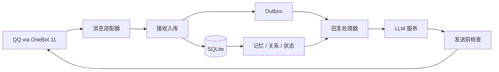

<div align="center">
  
  <h1>油木然-bot</h1>
  <p>住在 QQ 群里的角色机器人：它记得你们聊过什么，会看气氛说话，也可能自己冒出来搭一句。</p>
</div>

> [!IMPORTANT]
> 项目还在早期开发阶段（0.2.x）。核心链路已经有自动化测试覆盖，但还没经过真实 QQ 群的长期运行验收。想尝鲜可以自己部署一个，入口见下方文档导航。

## 它能做什么

- **持续记住你们**：聊天记录、关系（熟悉度、好感、信任）和角色状态都存在本地 SQLite 里，下次聊天还在。
- **有自己的状态**：每个角色在每个会话里有独立的心情值和压力值（自研设计），写进发给模型的上下文，影响它的语气和参与意愿。
- **会自己冒泡**：绑定开启主动发言后，它会按冷却时间和每日额度在群里搭话，不会刷屏。
- **可拓展**：插件是独立进程，通过 IPC 与主程序通信；插件崩溃不会拖垮主 bot。

以上每一条都有代码和测试支持。语音能力还在计划中，尚未开始开发。

## 在群里是什么感觉

把角色卡导入并绑定到一个群，它就在那个群里待着了。你可以：

- **@它说话**：默认它只回被 @ 的消息（回复模式可调）。
- **让它自然参与**：把绑定调成 natural 模式，它会根据当前心情和与你的关系决定接不接话、隔多久回。
- **让它自己搭话**：开启主动发言后，它会在冷却和额度允许时主动加入话题。

下面是一段虚构的示意对话，展示的是设计目标下的体验，不是某个真实群里的记录：

> **示意**

```text
阿茶：@油木然-bot 上次我们说的那个游戏叫什么来着？
油木然-bot：记得呀，是《星轨旅人》，你上周还立 flag 说这周通关来着。
阿茶：……你怎么记这么清
油木然-bot：毕竟你天天提（笑）
```

## 它记得什么、数据在哪

| 记录内容 | 存放位置 | 说明 |
| --- | --- | --- |
| 消息与会话记录 | 本地 SQLite（data/ 目录） | 每条消息保存作者、会话与引用关系 |
| 关系（熟悉、好感、信任） | 本地 SQLite | 按角色 × 全域用户记录，同一平台账号跨会话延续 |
| 角色心情与状态 | 本地 SQLite | 按角色 × 会话隔离 |

两点需要知道：

- **消息会发送给维护者配置的 LLM 服务**。bot 生成回复时，消息内容会作为上下文发给部署时配置的模型接口，具体提供商和地址由部署者决定。
- **想让它忘记你的内容**，可由维护者通过控制端删除记忆；删除全域用户时会清除关联记忆和旧账号标识，并匿名保留消息历史。

身份边界：同一平台账号在不同会话有各自的会话成员记录，但会关联到同一个全域用户身份；关系按“角色 × 全域用户”延续。跨会话记忆只允许召回该用户明确共享的内容，具体会话经历留在来源会话。自动审核并转正候选记忆尚未完成。

## 当前状态

| 类别 | 内容 |
| --- | --- |
| 已实现 | 角色卡导入、会话绑定、消息收发链路、记忆与关系、心情/状态模块、控制端 yomua-bot-ctl、插件 IPC |
| 试验中 | 主动发言节奏、多 Provider 备用链、决策模型接入 |
| 还没做 | 语音、候选记忆自动审核与转正、矛盾记忆修订 |

更完整的验证证据和已知问题见[项目现状](docs/status.md)。

## 架构一览



程序负责身份、权限、频率、并发和任务生命周期等硬约束；模型只负责理解上下文和生成回复，不能绕过程序的限制。详细分层和消息链路见[架构文档](docs/architecture.md)。

## 想自己跑一个

```bash
# 首次启动：在 ./config 生成配置模板，校验失败会退出
cargo run --locked --bin yomua-bot

# 填好 config/ 下的 OneBot 地址、bot QQ 号和 LLM 凭据后再次启动
cargo run --locked --bin yomua-bot

# 导入角色卡并绑定到群
cargo run --locked --bin yomua-bot -- import-card /path/to/card.json \
  --config-dir config --conversation 群号 --group --participant 你的QQ号
```

前置环境（Rust、OneBot 11 实现、SQLite）和配置项说明见[部署运维](docs/deployment.md)与[配置参考](docs/configuration.md)。

## 扩展它

插件是独立进程，通过 Unix socket 和 msgpack IPC 与主程序通信，可以订阅消息事件、读写自己的数据；不允许直接替角色发消息或改核心状态。最小示例在 examples/echo_plugin.rs，开发细节见[插件文档](docs/plugins.md)。

## 技术栈

- **Rust + tokio**：单进程异步运行时，负责消息处理、任务调度和插件监督。
- **SQLite（经 sqlx）**：所有持久化数据的存储层，单文件、便于备份。
- **OneBot 11**：QQ 消息接入协议，通过 WebSocket 与 OneBot 实现通信。
- **msgpack IPC**：主程序与插件进程之间的通信格式。

没有可引用的性能基准数据，这里只陈述事实：核心用 Rust 写成，存储用 SQLite，异步层基于 tokio。

## 参与与许可

- 问题反馈：[Issue 模板](.github/ISSUE_TEMPLATE)
- 贡献指南：[CONTRIBUTING.md](CONTRIBUTING.md)
- 许可证：[MIT License](LICENSE)
