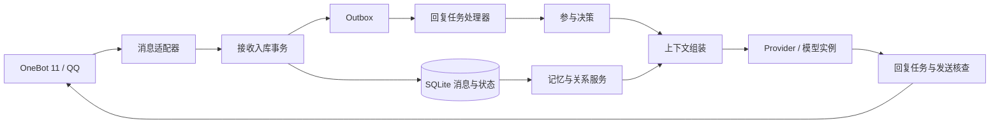

# yomua-bot

**面向 QQ 会话的持久角色运行时。** yomua-bot 用 Rust 管理角色、会话、关系、状态、记忆和回复任务，通过 OneBot 11 接入 QQ，通过兼容 Chat Completions 的服务调用语言模型。

> **开发状态**
>
> 当前版本是 `0.2.x` 开发版本，尚未达到 `v1.0.0` 的生产承诺。自动化检查已经覆盖主要本地链路，但真实 QQ/NapCat、外部模型、故障转移和长期运行仍需在隔离环境中验收。

## 你可以用它做什么

| 能力 | 当前状态 | 说明 |
| --- | --- | --- |
| 持久角色与会话绑定 | 已实现 | 一个 QQ 账号可在不同会话扮演不同角色；单个会话同时绑定一个角色。 |
| 消息接收与 Outbox | 已验证 | 消息、作者身份、观察角色、提及、引用和绑定版本在同一事务中保存。 |
| 连续消息合并 | 已验证 | 原消息逐条保留，短时间连续输入合并为一轮模型请求。 |
| 角色卡 | 已实现 | 支持 JSON/PNG 角色卡；真实角色体验仍需实际聊天验收。 |
| 记忆隐私边界 | 已验证 | 默认只显示摘要；读取原文必须显式请求，跨会话可见范围由程序控制。 |
| `yomua-bot-ctl` | 已验证 | 支持短命令、别名、REPL 历史与光标编辑、全屏 TUI 和结构化 Unix socket 协议。 |
| 多 Provider 与备用链 | 已验证 | Provider 与模型实例分离，可按任务配置备用链；真实服务地址、模型名和额度需要实测。 |
| 决策模型 | 已接入接口 | `decision.toml` 独立选择模型；输出只能作为建议，程序规则拥有最终裁决权。 |
| 语音通话 | 未接入 | 当前出站链路只有文本动作，语音能力另行设计。 |

## 最短上手流程

### 1. 准备工具

开发验证使用 Rust stable；目标部署环境为 Linux。QQ 接入还需要独立运行的 OneBot 11 WebSocket 服务，例如 NapCat 配套的 OneBot 实现。

```bash
cargo build --locked --lib --bins --examples
cargo test --locked --lib --bins
```

### 2. 生成配置模板

首次启动会在启动目录下创建 `config/`，补齐四份模板，然后以退出码 `1` 退出，避免在未填写密钥时直接启动：

```bash
cargo run --locked --bin yomua-bot
```

编辑以下文件中的占位值：

```text
config/runtime.toml    运行目录、管理员和关停超时
config/onebot.toml     OneBot WebSocket、Bot QQ 号和令牌
config/llm.toml        对话/认知 Provider、模型和备用链
config/decision.toml   参与判断与状态建议使用的决策模型
```

配置字段、首次启动行为和重载边界见[配置参考](docs/configuration.md)。根目录中已有的本地 `*.toml` 不会被删除；标准位置是 `config/`，需要使用旧位置时必须显式传入 `--config-dir .`。

### 3. 导入角色并启动

导入命令使用明确的二进制目标，路径和会话 ID 请替换为实际值：

```bash
cargo run --locked --bin yomua-bot -- import-card /path/to/character.json \
  --config-dir config \
  --conversation 123456 \
  --group

cargo run --locked --bin yomua-bot -- --config-dir config
```

### 4. 用 ctl 检查和关停

```bash
cargo run --locked --bin yomua-bot-ctl -- --data-dir data status --raw
cargo run --locked --bin yomua-bot-ctl -- --data-dir data --tui
cargo run --locked --bin yomua-bot-ctl -- --data-dir data shutdown --confirm
```

不带命令时，ctl 进入支持历史记录、上下键、光标编辑和 Tab 补全的 REPL。常用别名包括 `s`（`status`）、`c list`（`character list`）、`ss list`（`conversation list`）、`m list`（`memory list`）和 `cfg reload`（`reload-config`）。命令本由 ctl 维护，bot 只接收版本化结构化请求；完整命令见[CLI 参考](docs/cli.md)。

## 工作方式

消息入站后，适配器先把平台事件转换为结构化消息。应用层在一个事务里写入消息和 Outbox 事件，再由后台任务按会话顺序冻结一批连续输入、执行参与判断、组装上下文、调用模型并创建回复任务。发送前会再次检查角色绑定、停用状态和任务版本。



上下文优先级为：系统硬约束、角色卡、动态状态、可见记忆、历史、当前消息、回复格式要求。只有角色真实发出的消息才会以 `assistant` 身份进入历史；其他成员、其他 Bot 和被引用消息保留各自身份。

## 配置模型

首次发布可以只配置一个 Provider 和一个默认模型；同一 Provider 配置多个模型时，只需在 `llm.toml` 的 `model_instances` 中填写模型名，不必重复 URL。需要备用链时，为任务声明主模型和备用模型：只有网络错误、超时、HTTP 429 或 5xx 才会切换，认证失败、参数错误和响应格式错误会直接报告。

```toml
# config/llm.toml（结构示意，真实密钥只放本地文件）
[providers.primary]
provider_type = "openai-compatible"
base_url = "https://api.example.invalid/v1"
api_key = "REPLACE_WITH_KEY"

[model_instances.conversation]
provider = "primary"
model = "REPLACE_WITH_MODEL"

[roles.conversation]
model_instance = "conversation"
fallback_model_instances = []
```

Grok 等兼容接口按 Provider 配置，不在代码中写死厂商名称。决策模型单独放在 `config/decision.toml`，与对话模型分开控制超时、输出长度和单次 token 预算。完整字段和示例见[配置参考](docs/configuration.md)。

## 仓库导航

```text
src/             Domain、Application、Infrastructure、Adapters 及程序入口
tests/           集成测试
examples/        插件示例
docs/            当前架构、配置、运维、CLI、插件和验收说明
.github/         CI、问题模板和 PR 模板
config/          首次启动生成的本地模板（不提交真实密钥）
```

- [文档索引](docs/README.md)：按主题进入当前文档。
- [架构](docs/architecture.md)：分层、消息链路、状态边界和后台任务。
- [配置](docs/configuration.md)：四份配置文件、Provider 路由和重载规则。
- [部署运维](docs/deployment.md)：构建、启动、备份、关停和恢复边界。
- [CLI](docs/cli.md)：主程序工具、ctl 命令、别名和控制协议。
- [插件](docs/plugins.md)：插件生命周期、IPC 和权限限制。
- [项目现状](docs/status.md)：验证证据、未完成项和后续整顿顺序。
- [使用验收指南](docs/verification-guide.md)：按功能场景逐项检查。
- [贡献规范](CONTRIBUTING.md)：修改边界、检查命令和协作要求。

## 隐私与安全

配置密钥、运行数据、日志、NapCat 数据、角色卡素材和 Agent 记忆均属于本地内容，不应提交到 Git。控制 socket 目前依赖文件系统权限，能够访问 socket 的本机进程可以执行管理命令；部署时请使用专用用户并限制数据目录权限。

记忆默认不返回原文。ctl 的 `memory list` 只显示摘要和元数据，只有显式添加 `--raw` 才会读取原文；日志和错误输出仍可能包含会话相关信息，应按运行数据处理。

## 验证状态

当前工作树已通过库、主程序、ctl、集成测试、格式检查、严格 Clippy 和本地 Markdown 链接检查；具体数字和边界以[项目现状](docs/status.md)为准。以下内容仍需真实环境验证：

1. OneBot/NapCat 的真实收发、提及和角色切换。
2. 外部模型的真实响应格式、额度、延迟和备用链切换。
3. 长时间运行、信号关停、重启恢复和生产级数据备份。

在这些证据完成前，请将项目视为开发中的可验证组件，而不是已经发布的 `v1.0.0` 服务。

## 许可

[MIT](LICENSE)
