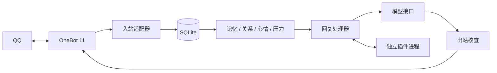

<div align="center">
  
  <h1>yomua-bot</h1>
  <p>一个住在 QQ 群里的 Rust 角色机器人：记住交流、感知状态，并按你的规则参与对话。</p>
  <p>
    <a href="https://github.com/yomua-cat/yomua-bot/blob/main/LICENSE"></a>
    <a href="https://www.rust-lang.org/tools/install"></a>
    <a href="https://github.com/yomua-cat/yomua-bot/actions/workflows/ci.yml"></a>
  </p>
</div>

> [!IMPORTANT]
> 当前版本为 **0.1.0**，仍处于早期开发阶段。核心链路已有自动化测试覆盖，但还没有经过真实 QQ 群的长期运行验收。

## 能力

- **持久记忆**：消息、关系和角色状态存储在本地 SQLite，重启后仍可继续使用。
- **心情与压力**：角色在会话中维护心情和压力状态，并参与回复决策。
- **主动发言**：可选开启；有冷却时间和每日额度，减少无节制刷屏。
- **独立插件**：插件以独立进程运行，通过 Unix socket + MessagePack IPC 通信；插件崩溃不会直接拖垮主程序。

## 回复方式

导入角色卡时可用 `--reply-mode` 选择绑定级策略。默认值是 `natural`。

| 模式 | 行为 |
| --- | --- |
| `natural` | 根据上下文、角色状态和行为判断自然参与对话。 |
| `mention` | 只处理被 @ 的消息。 |
| `occasional` | 偶尔参与普通消息，仍受行为判断和限额约束。 |

另加 `--proactive` 可开启主动发言调度；主动发言仍受冷却和每日额度限制。

## 快速开始

目标环境是 Linux；macOS 仅用于开发验证。控制服务和插件依赖 Unix socket，Windows 尚未验收。你还需要独立部署的 OneBot 11 服务（例如 NapCat）。SQLite 由 Rust 依赖自带，无需另装。

### 1. 构建

需要 Rust 1.88 或更高版本和可用链接器：

```bash
cargo build --release --locked --bin yomua-bot --bin yomua-bot-ctl
```

产物位于 `target/release/`。

### 2. 生成配置模板

在项目目录执行：

```bash
./target/release/yomua-bot
```

省略 `--config-dir` 时使用启动目录下的 `config/`。首次启动会生成缺失的四份模板并以退出码 `1` 退出，这是预期行为：

```text
config/runtime.toml
config/onebot.toml
config/llm.toml
config/decision.toml
```

### 3. 填写配置

至少修改：

- `runtime.toml`：`admin_users` 不能为空；`data_dir` 建议使用绝对路径。
- `onebot.toml`：填写 `websocket_url` 和 `access_token`。
- `llm.toml`：按 `Provider`、`model_instances`、`roles` 三层填写模型。暂时不使用模型时可写 `enabled = false`，此时只保存消息、不生成回复。
- `decision.toml`：可选，仅在使用独立决策模型时配置。

配置字段和示例见[配置参考](docs/configuration.md)。

### 4. 导入角色卡并绑定群

支持 `.json` 和 `.png` 角色卡：

```bash
./target/release/yomua-bot-ctl import-card /path/to/card.json \
  --config-dir config \
  --conversation <群号> \
  --group \
  --participant <QQ号> \
  --reply-mode natural \
  --proactive
```

`--participant` 用于创建群成员记录；不需要预先填写时可以省略。完整参数见[CLI 参考](docs/cli.md)。

### 5. 启动并检查

```bash
./target/release/yomua-bot --config-dir /absolute/path/to/config
```

另开终端检查运行状态：

```bash
./target/release/yomua-bot-ctl --data-dir /absolute/path/to/yomua-data status
./target/release/yomua-bot-ctl --data-dir /absolute/path/to/yomua-data character list
./target/release/yomua-bot-ctl --data-dir /absolute/path/to/yomua-data conversation list
```

每个实例必须使用独立的 `data_dir`；当前没有单实例锁。运行中的配置只有部分字段支持 `reload-config` 热重载，数据目录、OneBot 连接和模型路由等变更需要重启。

## 数据与隐私

> [!WARNING]
> 控制 socket 没有应用层身份认证。请只让专用运行用户访问配置、数据目录和 socket，不要把控制 socket 暴露给其他用户或网络代理。

- 数据保存在本地 SQLite：`data_dir/runtime.db`。
- 生成回复时，**消息正文、经净化的昵称、会话内匿名别名**会作为上下文发送给部署者配置的模型接口。历史用户会映射成“用户A”这类别名，不会发送真实 QQ 号；用户自己写进消息正文的号码仍会按原文发送。
- 维护者可以通过控制客户端删除记忆或用户。删除用户使用 `user delete <用户ID> --confirm`，会删除关联记忆和关系，同时匿名保留历史消息。

更多部署、备份和权限说明见[部署与运维](docs/deployment.md)。

## 文档导航

| 文档 | 适合阅读时机 |
| --- | --- |
| [部署与运维](docs/deployment.md) | 构建、启动、检查、关停、备份和升级 |
| [配置参考](docs/configuration.md) | 四份配置文件、模型路由和运行参数 |
| [CLI 参考](docs/cli.md) | 主程序子命令、`yomua-bot-ctl` 和危险操作 |
| [项目现状](docs/status.md) | 已实现、试验中、未完成和验证边界 |
| [架构](docs/architecture.md) | 消息链路、状态边界和后台任务 |
| [插件](docs/plugins.md) | 插件进程、IPC、权限和最小示例 |
| [使用验收指南](docs/verification-guide.md) | 按场景检查部署是否正常 |

## 架构一览



## 当前状态

以[项目现状](docs/status.md)为准：角色卡导入（JSON/PNG）、会话绑定、消息收发、记忆与关系、心情/状态、`yomua-bot-ctl` 和插件 IPC 已实现；主动发言节奏、多 Provider 备用链、决策模型仍在试验中；语音和矛盾记忆修订尚未完成。

## 扩展插件

插件是可信的独立进程，通过 Unix socket 和 MessagePack IPC 与主程序通信。插件不能代替角色发消息、修改核心状态或写入核心记忆；它不是操作系统沙箱，只运行你信任的代码。最小示例见 [`examples/echo_plugin.rs`](examples/echo_plugin.rs)，详见[插件文档](docs/plugins.md)。

## 技术栈

- Rust、Tokio：运行时和异步任务。
- SQLite、SQLx：本地持久化。
- OneBot 11、WebSocket：QQ 接入。
- MessagePack、Unix socket：插件 IPC。

## 参考项目与致谢

感谢以下开源项目公开分享设计思想和工程实践。本项目仅将它们作为架构、数据建模和测试方法的研究参考：

- [`companion-emergence`](https://github.com/hanamorix/companion-emergence/tree/10856ab9a9f6ba26e740f2b5196a1e2c7dc6b636)（MIT）：参考情绪状态、记忆关联与压缩、人格演化、状态衰减和离线行为等方向；相关设计规格见[框架重建设计](https://github.com/hanamorix/companion-emergence/blob/10856ab9a9f6ba26e740f2b5196a1e2c7dc6b636/docs/source-spec/2026-04-21-framework-rebuild-design.md)。
- [`SillyTavern`](https://github.com/SillyTavern/SillyTavern/blob/06bde939fb1e9c4c8d8641d810f0a916b5bce127/default/content/presets/openai/Default.json)（AGPL-3.0）：参考角色定义、提示词顺序、示例对话、上下文预算、Prompt Manager 和 World Info 的组织方式，另见其[Prompt Manager 文档](https://docs.sillytavern.app/usage/prompts/prompt-manager/)与[World Info 文档](https://docs.sillytavern.app/usage/core-concepts/worldinfo/)。
- [`eros-engine`](https://github.com/etherfunlab/eros-engine/tree/9715af2ce7d8524ca5ce8771059d436c31951977)（AGPL-3.0-only）：参考行为决策、关系状态更新、记忆流水线、流式处理和模型路由等架构方向，另见其[模型配置文档](https://github.com/etherfunlab/eros-engine/blob/9715af2ce7d8524ca5ce8771059d436c31951977/docs/model-config.md)。

本项目未复制上述项目的源码、默认 prompt、角色卡、第三方素材或供应商实现。`SillyTavern` 和 `eros-engine` 仅用于架构研究；如未来拟复用其中的具体实现，将另行进行许可证兼容性评估。

## 参与与许可

- 问题反馈：[Issue 模板](.github/ISSUE_TEMPLATE)
- 贡献指南：[CONTRIBUTING.md](CONTRIBUTING.md)
- 许可证：[MIT License](LICENSE)
