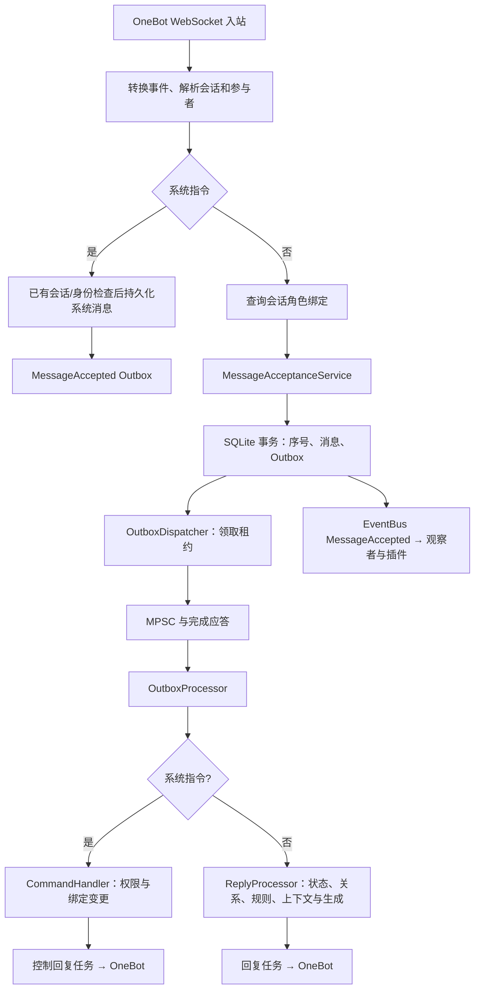

# 架构

本页描述当前程序的装配与调用关系。模型类型或接口存在，不等于相应能力已接入运行链路；接线缺口见[项目现状](status.md)。

## 分层与入口

| 层 | 职责与入口 |
| --- | --- |
| Domain | 角色、会话、消息、状态、决策、事件、Outbox 类型及仓储接口；[模块入口](../src/domain/mod.rs) |
| Application | 运行时、行为判断、上下文、认知、控制、导入与后台任务；[模块入口](../src/application/mod.rs) |
| Infrastructure | SQLite、HTTP 模型服务、角色卡解析、插件进程与 IPC；[模块入口](../src/infrastructure/mod.rs) |
| Adapters | OneBot 协议转换、连接、入站消息及出站调用；[模块入口](../src/adapters/mod.rs) |

[主程序](../src/main.rs)负责装配具体实现。Domain 通过仓储接口表达持久化需求；实际装配中 Application 也直接引用部分适配器和基础设施类型，不能把分层目标当成已验证的严格依赖隔离。

`yomua-bot` 是常驻程序及角色卡管理工具；`yomua-bot-ctl` 是 Unix socket 控制客户端。它们共享[库入口](../src/lib.rs)。

控制 socket 与插件 socket 的父目录在创建或绑定前收紧为 `0700`，socket 文件本身保持 `0600`；已有目录也会收紧权限，避免目录枚举或替换 socket。含 API key、access token 的配置结构在 `Debug` 输出中显示为 `<redacted>`，不改变 TOML 读写与相等比较。

## 启动与消息链路

启动流程为：读取配置并校验 → 初始化日志 → 创建数据目录、打开 SQLite 并迁移 → 装配仓储与服务 → 按配置启动插件 → 启动后台任务和控制 socket，并确认 socket 已成功绑定 → 启动 OneBot 适配器 → 等待控制关停信号。控制 socket 启动失败会阻止 OneBot 进入工作态并进入统一清理流程。

入站实现见[OneBot 适配器](../src/adapters/onebot/mod.rs)。系统指令先截流，只接受已有会话、参与者和角色绑定，然后作为 `author_kind=system_command` 的消息写入消息表和 Outbox；它不会进入普通角色上下文或插件消息订阅。普通消息无角色绑定时不进入消息落库及回复流程，但允许按需创建会话与发送者。

[消息接受服务](../src/application/message_acceptance.rs)调用[消息仓储](../src/infrastructure/storage/repository/message_repository.rs)，在同一事务内递增会话序号并写入消息和 Outbox 行。广播事件保留给插件和观察者；普通消息回复只由 Outbox Dispatcher/Processor 链路处理。`EventBus` 是尽力而为的内存广播：没有订阅者时事件直接丢弃，订阅者滞后超过容量时会丢弃旧事件并记录跳过数量；它不承担持久化或可靠消费职责。

OneBot 连接循环独立路由 Action 回执，不等待入站业务处理任务；下游通道积压时，连接循环先将普通事件暂存在内存 FIFO，最多 1024 条，以便继续读取并交付其后的回执。达到上限后会暂停 WebSocket 读取形成背压，因此极端入站积压仍可能延迟回执；该上限避免无界内存增长，压力场景尚未完成真实验收。入站处理器对数据库、仓储连接和 SQLite 锁等暂时性错误最多重试 3 次，使用递增短延迟，并在重试期间保持后续消息不被处理；永久错误、解析错误和业务性忽略不会重试。

[OutboxDispatcher](../src/application/outbox_dispatcher.rs)轮询、领取租约并等待消费者应答；[OutboxProcessor](../src/application/outbox_processor.rs)把 payload 转交[回复处理器](../src/application/reply_processor.rs)。租约、轮询和重试策略是代码默认值，当前没有对应 TOML 字段；数据库、发送和通用传输错误沿用短退避，LLM 响应内容无效或限流使用更长的重试次数与退避。429 的 `Retry-After` 会被保留并受 120 秒上限及事件过期时间约束。消费者成功后标记完成，失败可转入等待重试或死信；永久失败事件记录后不会阻塞同一会话后续事件。

这条链路不构成端到端可靠投递保证：控制回复和普通回复都已进入持久回复任务。OneBot 超时没有平台消息 ID 时，机器人自身回声会在同一会话内按正文完全一致、发送开始后 60 秒内且候选唯一的条件尝试收敛为 `sent`，并写入回声携带的平台消息 ID；匹配不唯一、不一致、跨会话或超出窗口时仍保持 `unknown`。没有回声时仍需人工核查，回声匹配只确认已发生的发送，不触发自动补发。完成状态只能按实际实现解释，不能据此推断 QQ 用户已收到消息。

## 角色与状态边界

| 数据 | 作用域 | 当前内容 |
| --- | --- | --- |
| 角色定义 | Character | 人格、场景、提示、示例、Lorebook 与元数据 |
| CharacterState | Character | energy、stress、current_activity、last_updated |
| ConversationState | Character × Conversation | 会话精力、压力与更新时间 |
| Mood | Character × Conversation | mood 标量与更新时间 |
| BehaviorState | Character × Conversation | 主动行为冷却时间 |
| User | `(platform, external_id)` | 跨会话稳定的平台用户身份；支持审计合并与删除 |
| Participant | Conversation × external_id | 会话内显示名、作者身份和消息归属，不能替代 User |
| Relationship | Character × User | 关系数值与跨会话交互记录；领域对象保存 `user_id`，会话 `participant_id` 只用于入站解析；交互幂等表同样按 `user_id` 归并 |
| Memory | Character × 可选 User，可附会话 | 记忆来源和用户归属；稳定事实和关系信息默认可跨会话召回，且只作为角色内部上下文使用，不向用户透露来源会话；确认禁用策略后停止未来跨会话检索，非共享经历留在来源会话，候选记忆仍不可见 |
| CharacterBinding | Conversation → Character | 回复模式、主动行为、静默时段和普通回复限额等绑定设置 |

[领域模型](../src/domain/character.rs)与[情绪模型](../src/domain/emotion.rs)定义状态。[角色运行时](../src/application/runtime.rs)按需加载并缓存角色，以每角色锁保护状态更新。控制命令直接写仓储时与缓存同步的关系仍需整顿。

当前绑定管理强制每会话一个角色；迁移发现重复绑定会拒绝启动并要求先明确保留项。接收时记录的角色 ID 与消费时重新读取绑定的方式共同参与发送前校验，绑定版本变化会取消旧任务。

## 决策、上下文与模型

[规则行为引擎](../src/application/behavior_engine.rs)从绑定、回复模式、提及、静默时段、状态和关系生成完整 `BehaviorDecision`，并同时返回一次性输入快照。规则确认本次将回复后，会在调用决策模型和生成模型前原子预留普通回复限额；命中时动作改为 `Ignore`，原因是 `rate_limited`。限额按绑定内参与者和会话分别统计，SQLite 保留最近事件以跨重启延续滑动窗口。编排器把快照转换为模型 DTO：情境及消息文本、角色/会话 ID、是否绑定与行为配置、关系指标、角色全局状态和会话状态；再与完整规则决策一起发送。决策模型只能返回 `keep`、`suggest_reply`、`suggest_ignore` 或 `adjust_delay`，可附理由和置信度，不能生成回复文本或直接改变状态。

`decision.toml` 启用后，请求经 `DecisionLlmServiceImpl` 以 `llm_role=decision` 交给调度器。明确提及由规则引擎直接处理；未提及消息只有规则结果或关系/状态处于边界时才由启发式触发器调用模型。主动任务先通过规则引擎的主动开关、静默、冷却和意愿门槛，再由同一编排器评估；模型保留后原子预留额度并入队，入队失败会恢复预留前状态，模型否决则不产生主动消息副作用。主动情境只接受 `keep` 或 `suggest_ignore`，不接受回复建议或延迟调整。

绑定为 `MentionOnly` 且消息未提及时，回复处理器在记忆抽取、关系更新、批量等待和决策模型之前直接持久化 `Ignored`；这是规则硬约束的提前短路，不改变被提及时的回复路径。

配置路由负责 Provider、模型、输出上限、共享预算和网络/HTTP 可重试备用模型。普通聊天模型返回 JSON 建议；Jev 通过 TypeSafe Provider 发送 `state + choice question`，再由决策服务转换为同一组动作。Pipeline 对建议做语义校验，失败时回到规则决策；编排器应用建议时再次守住硬约束。未绑定、MentionOnly 模式下未提及、静默时段下未提及和主动情境不能被建议回复绕过；规则决策仍保留优先级、认知级别、原因和时间等字段。全部模型失败、输出无效或未触发模型时都使用规则结果。

[ContextBuilder](../src/application/context.rs)加载角色归属的历史、Lorebook、记忆、关系及会话情绪。调用方显式传入全域 `user_id`，participant 只用于本会话消息作者与当前轮身份；跨会话记忆和关系均以该 `user_id` 查询。稳定事实和关系信息默认纳入角色内部上下文，确认禁用策略后由数据库层排除；具体经历仍限于来源会话。[CharacterHistoryProvider](../src/application/character_history.rs)负责历史归属和序号边界。[ContextAssembler](../src/application/context_assembler.rs)估算 token、预留输出空间并按层降级，需要已知的 `context_window`；历史用户标签使用会话内稳定匿名别名，昵称和正文标签会先做安全净化，系统生成的身份标签不包含真实 QQ 号。模型能力从当前 Role 引用的 Model Instance 解析；共享预算和备用模型数配置在对应的 `[roles.*]` 中。

全域用户删除由 `ParticipantRepository` 在 SQLite 事务内执行：删除该用户来源的普通/向量记忆和关系数据，匿名化会话参与者、OneBot 私聊路由、消息/outbox 作者元数据与用户黑名单，再删除 `users` 身份。为保留历史审计与引用，消息行、正文和内部引用关系保留；历史作者显示为“已删除用户”，旧私聊主动发言会关闭。任何步骤失败都会回滚整笔删除。

[认知层](../src/application/cognition.rs)通过[调度器](../src/application/llm_scheduler.rs)发起请求，HTTP 实现在[OpenAI-compatible Provider](../src/infrastructure/llm/openai_compatible.rs)。Provider 连接与对话模型来自 `llm.toml`，独立决策模型来自 `decision.toml`，同一 Provider 可复用多个模型。LLM 关闭时保留消息并跳过生成，不发送伪造回复；启用后模型或上下文错误会按 Outbox 失败路径处理。

主程序没有给 ContextBuilder 注入 embedding scheduler，因此当前对话上下文使用关键词 Lorebook 与记忆检索。认知后台使用统一的 embedding scheduler；Provider 可在 `llm.toml` 中配置可选 `embedding_model`，未配置时只跳过向量增强。向量检索接口若被调用，必须带当前会话和稳定用户身份，由 SQL 先限制可见范围后再排序；存在语义存储或混合检索接口不代表对话已经使用 RAG。

## 后台任务与持久化

- 常驻任务：事件观察、主动行为评估、Outbox 调度和消费、控制服务、适配器连接与入站处理；系统指令在 Outbox 消费任务内处理。
- 插件注册表、插件监督器和 OneBot pending 请求使用可恢复的标准互斥锁；锁中毒时记录错误并继续使用内部数据，避免单个任务 panic 连锁拖垮主进程。
- LLM 启用后启动后台认知任务，使用 `cognition` role；插件启用后增加事件桥接、传输和进程监督任务。
- 主动行为驱动会在已有话题依据、冷却、静默和每日上限通过后，以 SQLite 原子事务预留额度并创建持久回复任务；入队失败会回滚额度，避免无消息却消耗冷却。没有已有话题依据时不会发言。主动合成消息不会更新用户关系或记忆。
- 回复任务的生成领取、生成结果、失败回退、过期/取消/忽略状态和实际发送都绑定当前 Outbox 租约；SQLite 在同一条条件写入中检查租约，失去租约的旧 worker 不能覆盖新状态，过期的 `generating` 任务可由新租约接管。平台网络调用本身仍没有幂等键，租约在网络调用期间失效时依靠 `unknown` 核查流程兜底；自身平台回声可按严格唯一匹配条件补写确认结果，但不会改变未知任务的补发策略。
- Outbox 租约过期并达到最大尝试次数时，恢复事务会同步收口回复任务：`sending` 保留为 `unknown` 并等待平台核查，尚未发送的 `pending/generating/generated` 标记为 `failed`，避免留下无法继续处理的假进行中任务。
- 模型明确拒绝请求（例如 4xx）时，Outbox 将事件标为 `dead_letter`，对应回复任务标为 `failed`；供应商返回空 choices、缺少 content 或无法解析的响应会进入 LLM 专用重试；Provider 只记录脱敏的结构化错误说明，避免把同一无效请求重复发送。死信日志包含事件 UUID、会话和错误分类，不向用户自动发送错误消息。
- OneBot 明确拒绝发送时同样进入 `dead_letter`/`failed`；连接暂不可用仍保留生成内容并进入 Outbox 重试，不把“尚未发送”误记为未知送达。
- 入站消息产生的记忆先持久化为带来源的候选；后台维护任务通过 `decision` 路由请求审核模型，模型只提出 `confirm`、`reject` 或 `defer`，SQLite 再验证来源消息、用户、会话、类型和置信度后正式化，审核模型不可用或意见不合规时保持候选。自然语言记忆修改也先持久化为 pending；后台维护任务会限量扫描并重放崩溃遗留请求，失败保留重试信息，成功或拒绝均写回审计状态，不把记忆正文放进普通控制响应。
- SQLite 使用 WAL、外键约束和连接池。[迁移](../src/infrastructure/storage/migrations.rs)在代码中执行并探测已有表列，没有独立迁移文件或自动回滚机制。
- 控制关停会发广播信号、停止插件与适配器、等待后台任务，向已接受的控制请求返回关停结果并等待控制服务连接退出，最后关闭存储；超出 `shutdown_timeout_secs` 后取消剩余任务，保留未完成回复供核查，详见[部署运维](deployment.md)。关停超时配置在运行期不热更新，修改后需重启。
